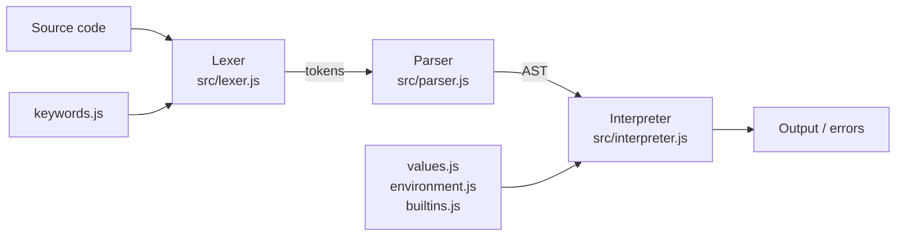

# প্রবাহ · Probaho

**A small programming language you write in Bangla.** Keywords, numbers, variable names and error messages all work in Bangla, with English aliases if you prefer. It runs entirely in the browser, with no backend and zero dependencies.

**[▶ Try the playground](https://aranyasardar10.github.io/Probaho/)**

<!-- Add a short screen recording here:  -->

```
ফাংশন ফ্যাক্টোরিয়াল(ন) {
  যদি ন <= ১ { ফেরত ১ }
  ফেরত ন * ফ্যাক্টোরিয়াল(ন - ১)
}
ছাপো ফ্যাক্টোরিয়াল(৫)      # 120
```

## Why

Most programming tutorials assume you read English before you read code. Probaho lets a beginner write their first loop and function in the language they think in, and see errors that explain themselves in Bangla and English.

## Features

- **Bangla keywords** (`ধরি`, `যদি`, `নাহলে`, `যতক্ষণ`, `ফাংশন`, `ফেরত`, `ছাপো`) with English aliases (`let`, `if`, `else`, `while`, `fn`, `return`, `print`)
- **Bangla digits** in source code (`১২.৫`) and an option to print results in Bangla digits
- **Bangla identifiers**, including conjuncts and vowel signs (`ধরি ফল = ৫`)
- **Playground** with live syntax highlighting, Bangla line numbers and shareable links
- **Two-language error messages** with the line and a caret under the problem
- Functions, recursion, closures, lists, strings, `break` / `continue`
- **Safe for a playground:** infinite loops and runaway recursion are stopped with an error
- Bangla-aware strings: `দৈর্ঘ্য("কি")` is 1, because a reader sees one character
- Pure JavaScript, no dependencies, tested on Node 18, 20 and 22

## Error messages

```
ত্রুটি (লাইন ২): 'ফল' নামে কোনো ভেরিয়েবল পাওয়া যায়নি
Error (line 2): variable 'ফল' is not defined
    ছাপো ফল + ১
         ^
```

## Run it

You need [Node.js](https://nodejs.org) 18 or newer.

```bash
git clone https://github.com/aranyasardar10/probaho.git
cd probaho

npm test                          # run the test suite
node run.js examples/fizzbuzz.pb  # run a program from the command line
npm start                         # open the playground at http://localhost:8000
```

The playground uses ES modules, so open it through `npm start`, not by double-clicking `index.html`.

## The language in 60 seconds

| Bangla | English alias | Meaning |
|---|---|---|
| `ধরি x = ৫` | `let` | declare a variable |
| `যদি … নাহলে …` | `if … else …` | condition |
| `যতক্ষণ` | `while` | loop |
| `থামো` / `পরেরটা` | `break` / `continue` | loop control |
| `ফাংশন` / `ফেরত` | `fn` / `return` | functions |
| `ছাপো` | `print` | output |
| `সত্য` / `মিথ্যা` | `true` / `false` | booleans |
| `এবং` / `অথবা` / `না` | `and` / `or` / `not` | logic |

Built-ins: `দৈর্ঘ্য(x)` length, `যোগ(list, x)` append, `সংখ্যা(x)` to number, `লেখা(x)` to string.

Full reference: **[docs/LANGUAGE.md](docs/LANGUAGE.md)**. More programs: [`examples/`](examples).

## How it works



1. **Lexer** turns text into tokens. It understands Bangla letters, vowel signs and digits, and tracks line and column for every token.
2. **Parser** is a hand-written recursive descent parser that builds a syntax tree following the grammar in the language reference.
3. **Interpreter** is a tree-walking evaluator with lexical scopes, closures, and step and recursion limits.

```
src/
  keywords.js     all keywords in one table (add aliases or languages here)
  lexer.js        text -> tokens
  parser.js       tokens -> syntax tree
  interpreter.js  runs the tree
  values.js       formatting, truthiness, equality, Bangla digits
  environment.js  scopes
  builtins.js     দৈর্ঘ্য, যোগ, সংখ্যা, লেখা
  errors.js       two-language errors with a caret
  index.js        run() and runProgram() for the CLI and the playground
tests/            lexer, parser, interpreter, and every example program
examples/         .pb programs, each with a .expected output file
index.html        the playground
```

## Tests

```bash
npm test
```

The suite covers the lexer, the parser (including operator precedence), the interpreter (scoping, closures, errors, limits) and runs every program in `examples/` against its `.expected` file. CI runs it on Node 18, 20 and 22 for every push.

## Add your own keyword or language

Open `src/keywords.js` and add a line, for example an alias:

```js
'লুপ': 'WHILE',
```

Every alias maps to the same token type, so nothing else needs to change. Other languages work the same way. Pull requests with new aliases, examples, or translated error messages are welcome.

## Roadmap

- [ ] `for` loop and ranges
- [ ] String functions (split, join, upper-case for English)
- [ ] Dictionaries
- [x] Syntax highlighting in the playground
- [ ] Bytecode compiler and VM
- [ ] VS Code extension
- [ ] `import` for multi-file programs

## License

[MIT](LICENSE)
